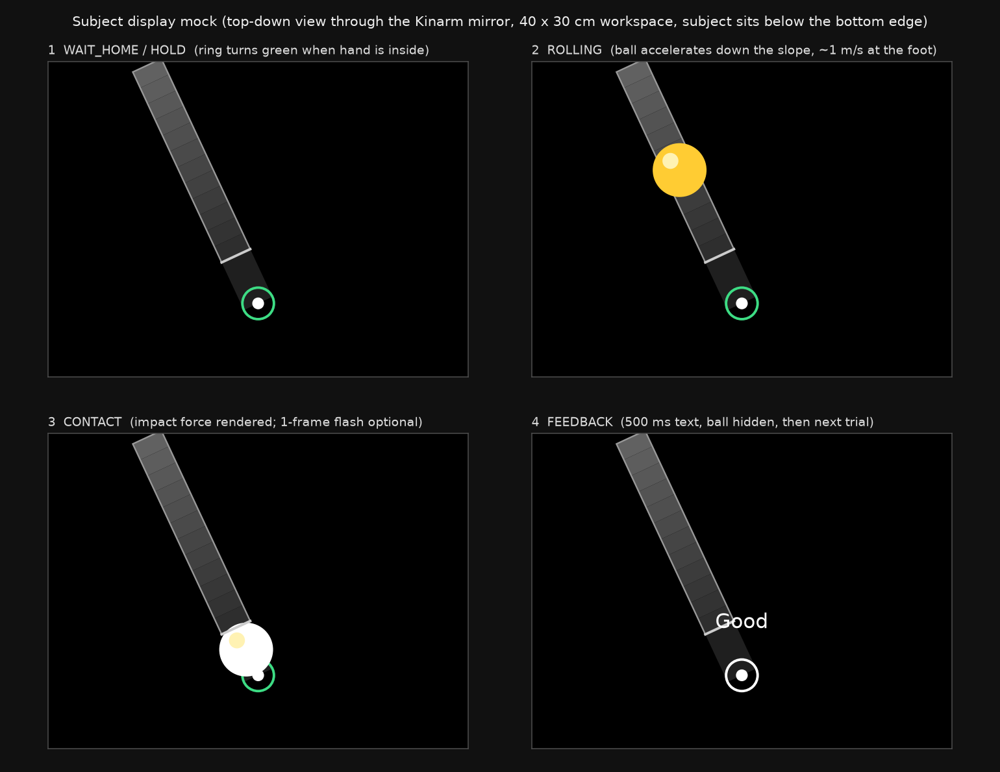

# Display and operator UI design

Status: v0.2 (2026-11-20). Layout (sections 1, 2) approved. Trial event sequence (section 3) is a placeholder, NOT yet decided. Block names marked (verify) must be checked against the
Dexterit-E 3.5 *Creating Task Programs* guide once the TDK is downloaded.

## 0. What "UI" means on a Kinarm

| Surface | Who sees it | What draws it | How much you control |
|---|---|---|---|
| Virtual-reality display (horizontal screen seen via mirror, top-down view of the workspace) | Subject | Your Simulink task: target-table rows turned on/off and moved every tick | Everything that appears, within the primitives the TDK offers |
| Dexterit-E operator window | Experimenter | Dexterit-E | Parameter tables, instruction text, task buttons, trial notes. Layout is fixed |
| Instructions | Subject (read by operator or shown on display) | Protocol `instructions` field plus display text objects | Text only |

There is no separate GUI toolkit. The subject display is built entirely from the target
table primitives (circles, rectangles, lines, text; images in 3.5 via the image-display
mechanism used by Kinarm's "image display spring demo", which was compiled for 3.5 and
R2013a), each positioned in workspace coordinates in centimetres. The task program moves
objects by writing their position and visibility each control tick (verify block names:
target position / visibility inputs in the KINARM_general library).

## 1. Subject display: layout

Workspace is roughly 40 x 30 cm in front of the subject (End-Point). Coordinates below are
in the global frame, x right, y away from the subject, origin at the Kinarm centre.
Keep every element at least 3 cm inside the reachable limits so the ball never leaves
the visible area before the trial ends.

```
             y (away from subject)
             ^
   +---------------------------------------+
   |                                       |
   |        (slope top)  o  ball start     |   slope: a shaded strip 20 cm long,
   |                    /                  |   tilted 25 deg from the y axis
   |                   /  <- slope strip   |   (direction d = ball travel)
   |                  /                    |
   |          (foot) /                     |   flat run 5 cm
   |                V                      |
   |               [H]  <- home target,    |   hand cursor sits here
   |                      hand cursor      |
   |                                       |
   +---------------------------------------+ -> x
```

Rationale for a diagonal, not straight-at-the-body, approach: the impact force then has
components the arm can absorb at the elbow and shoulder, and a diagonal keeps the ball's
whole path inside the display. Mirror the direction across subjects or blocks if
handedness or direction effects matter.

## 2. Elements and their rendering

| Element | Primitive | Size / colour | Behaviour |
|---|---|---|---|
| Background | none | black (the display is dim; use high contrast) | static |
| Slope strip | rectangle or two lines | 3 cm wide, 20 cm long, dark grey fill with a lighter edge; optional brightness gradient along d to imply "downhill" | static per trial |
| Slope foot marker | short line across the strip | light grey | static |
| Ball | filled circle | radius = r_b (2 to 4 cm), bright colour (yellow or orange); optional smaller highlight dot offset toward the top-left to give a sense of volume | position written every tick from the ball model; hidden until RELEASE |
| Home target | ring | radius 1.5 cm, white when hand outside, green when hand inside | colour switches on the hand-in-target signal |
| Hand cursor | filled circle | radius 0.5 cm, white | Dexterit-E draws it; keep it visible so the subject can see the ball reach the hand |
| Hand "paddle" (optional) | ring of radius r_h | thin, same colour as cursor | makes the contact radius explicit; drop it if you want the subject to feel the contact size, not see it |
| Fixation cross (optional) | two lines | 1 cm, white | only if gaze control matters |
| Feedback text | text object | 1 line, 1 cm tall, centred above home | "Hold still", "Too early", "Good" for 500 ms |
| Block instructions | text, 2 to 3 lines | centred | shown between blocks until the operator presses a task button |

Visual-haptic congruence: if ball mass is manipulated, decide explicitly whether the
visual ball changes (size, colour, texture) with mass. If the question is about haptic
mass perception, keep the visual identical across masses and vary only the haptics.

## 3. Trial storyboard (PLACEHOLDER: event sequence not yet decided)

| Phase | Display | Haptics | Exit |
|---|---|---|---|
| WAIT_HOME | slope, foot marker, home ring (white), cursor. Ball hidden | none | hand inside home for hold_time |
| HOLD | home ring turns green. Random 0.5 to 1.5 s delay if release timing should be unpredictable | none | timer |
| RELEASE | ball appears at slope top | none | immediately |
| ROLLING | ball moves along d, accelerating; updated every tick | none | pen > 0 |
| CONTACT | ball overlaps hand; optional 1-frame flash of the ball or paddle | impact force | pen <= 0 |
| POST | ball rolls or bounces away; cursor free | none | ball stops or leaves area, or 1 s |
| FEEDBACK | text for 500 ms; ball hidden | none | timer |
| ITI | blank except home ring | none | 0.5 to 1 s |

Abort rules (show "Hold still" and restart): hand leaves home ring during HOLD or
ROLLING when the design requires a stationary hand.

## 4. Timing and motion quality

- The display refreshes at ~60 Hz while the control loop runs at 1 kHz or more. Write the
  ball position every tick; Dexterit-E samples it at each frame.
- A 1 m/s ball moves 1.7 cm per frame at 60 Hz. That is acceptable but visibly steppy; a
  motion-blur streak is not available, so keep ball speed under ~1.5 m/s and the ball
  radius at least 2 cm so each frame overlaps the previous one.
- Display latency (render plus mirror path) is typically 1 to 3 frames on Kinarm
  systems. Dexterit-E 3.5 does not expose a latency-compensation signal (that arrived
  later), so measure it once with the lab's photodiode or by stepping a target and
  logging the frame, and if needed lead the drawn ball by the measured lag so the
  visual arrival and the haptic impact coincide. Visual-haptic asynchrony above ~40 ms
  is noticeable and breaks the "ball hit my hand" percept.
- Hide the ball exactly at CONTACT_END if you want the impact to feel instantaneous;
  otherwise let the simulation carry it away. Mismatch between where the ball is drawn
  and where force is felt is the most common realism failure.

## 5. Operator UI (Dexterit-E side)

- **Task buttons** (Parameter Table Defn, logged as TASK_BUTTON_n_CLICKED): Start block,
  Repeat trial, Pause, Skip to next block. Group them in one 1x4 row.
- **Instructions field** of each protocol: the exact script the operator reads.
- **Parameter descriptions** in the load and TP tables: write them so a future operator
  can tell "k_c 2000" from "k_c 4000" without opening the Simulink model.
- Trial notes: use Dexterit-E's trial-notes mechanism for aborted trials rather than
  inventing codes.

## 6. Accessibility and safety

- Instruct the subject that the robot will push on the hand; demonstrate with the
  lightest condition first (familiarisation block, 10 trials).
- Keep a "haptics off" protocol row for subjects who find the impact unpleasant.
- All force commands pass through the F_max clamp in the model and Dexterit-E's own
  safety limits remain active.

## 7. Open design decisions

1. Diagonal approach direction and whether to mirror it across blocks.
2. Visual ball identical across masses, or cued?
3. Show a hand paddle ring, or only the cursor?
4. Feedback after each trial, or none (to avoid shaping behaviour)?



Rendered by `sim/mock_display.py`.
